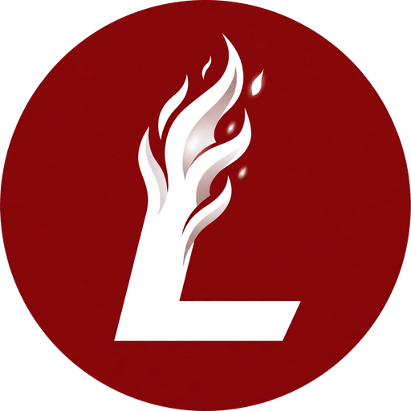

<p align="center">
  
</p>

<h1 align="center">Lume</h1>

<p align="center"><b>A conversational assistant written in BotQL, with programming as its test domain.</b></p>

<p align="center">
  <a href="https://github.com/adilson889/lume/stargazers"></a>
  <a href="LICENSE"></a>
  <a href="https://github.com/adilson889/lume/commits/main"></a>
  
  
  
</p>

<p align="center"><a href="README.md">Português</a> &nbsp;|&nbsp; <a href="README.en.md">English</a> &nbsp;|&nbsp; <a href="README.zh.md">中文</a></p>

---

## What it is

<p align="justify">
Lume is a chatbot built entirely with <a href="https://github.com/adilson889/botql">BotQL</a>, a declarative, rules-based language. It is not a trained language model: it combines rules, a hand-written knowledge base, what it has learned from users and web search, and it works out the intent of each message to decide what to do with it.
</p>

<p align="justify">
The test domain is programming: variables, functions, loops, classes, APIs, Git, SQL, HTML, CSS and other introductory topics. The goal is a solid, scalable base where growing means adding text files rather than rewriting logic.
</p>

## How it answers

<p align="justify">
Every message first goes through conversation rules (help, greetings, farewells, thanks, status). Whatever is left follows a chain in which each step acts only when the previous one fails:
</p>

1. **Hand-written base** (`conhecimento_programacao.txt`): a direct answer.
2. **Learned** (`aprendido.txt`): what Lume has already learned, answered directly or, when in doubt, through a poll that lets the user choose.
3. **Web search** (Wikipedia): runs only when the message looks like a programming question. The result is saved into the learned file.
4. **Base poll**, when several answers are possible.
5. **Fallback reply**, when nothing fits.

<p align="justify">
The poll lists the possible answers with numbers and disappears as soon as the user picks one.
</p>

## Message intent

<p align="justify">
The chat uses <a href="https://github.com/axa-group/nlp.js">NLP.js</a>, bundled into a single file (<code>LUME/vendor/nlp.min.js</code>, 127 KB), to classify each message as a topic from the base, small talk, off-topic, or programming the base does not cover yet. It trains when the page opens, in under a second, from the base topics and the examples in <code>LUME/bot/intencoes.txt</code>. This way a question such as "who is Messi?" does not go to the web and bring back noise.
</p>

<p align="justify">
To teach an intent, add lines in the form <code>intent | example phrase</code> to <code>intencoes.txt</code>.
</p>

## Learning from users

<p align="justify">
Every answer can get a thumbs up or down. After a thumbs down, the user can teach the right answer in an editor with formatting, preview and validation (length, HTML only inside code blocks, links only to Wikipedia and Stack Overflow). What is taught or learned can be reviewed, approved or removed in a management panel.
</p>

## Repository layout

```text
index.html                  chat (static page, no build step)
LUME/
  bot/                      main.sql and the text files it uses
    arquivos.json           list of files the chat loads
    conhecimento_programacao.txt
    intencoes.txt
    aprendido.txt
  vendor/nlp.min.js         NLP.js as a single file
  assets/logo.png
  tests/casos_programacao.txt   test cases (question | expected answer)
  CHANGELOG.txt, VERSION
```

## Run locally

<p align="justify">
Lume is a static page that loads the BotQL engine over the network. Just serve it over HTTP (opening the file directly does not work, because of the <code>fetch</code> requests):
</p>

```bash
git clone https://github.com/adilson889/lume.git
cd lume
python3 -m http.server 8000
# open http://localhost:8000
```

## Adding knowledge

<p align="justify">
Each topic in the base is a block separated by a blank line, in the form <code>Topic (synonyms): answer text</code>. When you create a new file, list it in <code>LUME/bot/arquivos.json</code>, because the chat only loads what is on that list. BotQL file names are plain: letters, numbers and underscores, no folders.
</p>

## Versions

<p align="justify">
The changes in each version are in <a href="LUME/CHANGELOG.txt">LUME/CHANGELOG.txt</a>, and the current version is in <a href="LUME/VERSION">LUME/VERSION</a>.
</p>

## License

<p align="justify">
Released under the Apache 2.0 license. See <a href="LICENSE">LICENSE</a>. NLP.js, bundled in <code>LUME/vendor</code>, is released under the MIT license.
</p>
