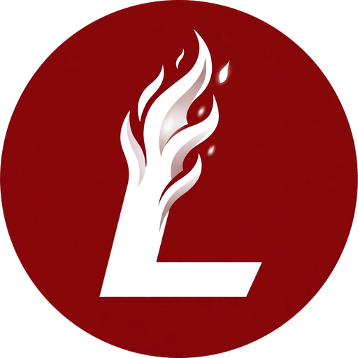

<p align="center">
  
</p>

<h1 align="center">Lume</h1>

<p align="center"><b>Assistente conversacional escrito em BotQL, com programação como domínio de teste.</b></p>

<p align="center">
  <a href="https://github.com/adilson889/lume/stargazers"></a>
  <a href="LICENSE"></a>
  <a href="https://github.com/adilson889/lume/commits/main"></a>
  
  
  
</p>

<p align="center"><a href="README.md">Português</a> &nbsp;|&nbsp; <a href="README.en.md">English</a> &nbsp;|&nbsp; <a href="README.zh.md">中文</a></p>

---

## O que é

<p align="justify">
O Lume é um bot conversacional construído integralmente com o <a href="https://github.com/adilson889/botql">BotQL</a>, uma linguagem declarativa baseada em regras. Não é um modelo de linguagem treinado: é um sistema que combina regras, uma base de conhecimento escrita à mão, o que aprendeu com os utilizadores e pesquisa na web, e que percebe a intenção de cada mensagem para decidir o que fazer com ela.
</p>

<p align="justify">
O domínio de teste é a programação: variáveis, funções, ciclos, classes, APIs, Git, SQL, HTML, CSS e outros temas de iniciação. O objetivo é ter uma base sólida e escalável, em que crescer significa acrescentar ficheiros de texto e não reescrever lógica.
</p>

## Como responde

<p align="justify">
Cada mensagem passa por regras de conversa (ajuda, saudações, despedidas, agradecimentos, estado). O que sobra segue uma cadeia em que, quando um passo não resolve, o seguinte atua:
</p>

1. **Base escrita à mão** (`conhecimento_programacao.txt`): resposta direta.
2. **Aprendido** (`aprendido.txt`): o que o Lume já aprendeu, em resposta direta ou, havendo dúvida, numa sondagem para o utilizador escolher.
3. **Pesquisa na web** (Wikipédia): só corre quando a mensagem parece ser de programação. O resultado é gravado no aprendido.
4. **Sondagem da base**, quando há várias respostas possíveis.
5. **Resposta de reserva**, quando nada serve.

<p align="justify">
A sondagem mostra as respostas possíveis numeradas e desaparece assim que o utilizador escolhe uma.
</p>

## Intenção da mensagem

<p align="justify">
O chat usa o <a href="https://github.com/axa-group/nlp.js">NLP.js</a>, empacotado num único ficheiro (<code>LUME/vendor/nlp.min.js</code>, 127 KB), para classificar cada mensagem como um tema da base, conversa, fora do tema ou programação que a base ainda não cobre. Treina ao abrir a página, em menos de um segundo, com os temas da base e com os exemplos de <code>LUME/bot/intencoes.txt</code>. Assim, perguntas como "quem é o Messi?" não vão à web buscar ruído.
</p>

<p align="justify">
Para ensinar uma intenção basta acrescentar linhas no formato <code>intencao | frase de exemplo</code> a <code>intencoes.txt</code>.
</p>

## Aprender com os utilizadores

<p align="justify">
Cada resposta pode receber um voto positivo ou negativo. Com um voto negativo, o utilizador pode ensinar a resposta certa num editor com formatação, pré-visualização e validação (tamanho, HTML só dentro de blocos de código, links só da Wikipédia e do Stack Overflow). O que é ensinado ou aprendido pode ser revisto, aprovado ou removido num painel de gestão.
</p>

## Estrutura do repositório

```text
index.html                  chat (página estática, sem compilação)
LUME/
  bot/                      main.sql e os ficheiros de texto que ele usa
    arquivos.json           lista dos ficheiros que o chat carrega
    conhecimento_programacao.txt
    intencoes.txt
    aprendido.txt
  vendor/nlp.min.js         NLP.js em ficheiro único
  assets/logo.png
  tests/casos_programacao.txt   casos de teste (pergunta | resposta esperada)
  CHANGELOG.txt, VERSION
```

## Executar localmente

<p align="justify">
O Lume é uma página estática que carrega o motor do BotQL pela rede. Basta servi-la por HTTP (abrir o ficheiro diretamente não funciona, por causa dos pedidos <code>fetch</code>):
</p>

```bash
git clone https://github.com/adilson889/lume.git
cd lume
python3 -m http.server 8000
# abrir http://localhost:8000
```

## Acrescentar conhecimento

<p align="justify">
Cada tema da base é um bloco separado por uma linha em branco, no formato <code>Tema (sinónimos): texto da resposta</code>. Ao criar um ficheiro novo, é preciso listá-lo em <code>LUME/bot/arquivos.json</code>, porque o chat só carrega o que está nessa lista. Os nomes de ficheiro do BotQL são simples: letras, números e sublinhado, sem pastas.
</p>

## Versões

<p align="justify">
As alterações de cada versão estão em <a href="LUME/CHANGELOG.txt">LUME/CHANGELOG.txt</a>, e a versão atual em <a href="LUME/VERSION">LUME/VERSION</a>.
</p>

## Licença

<p align="justify">
Distribuído sob a licença Apache 2.0. Ver <a href="LICENSE">LICENSE</a>. O NLP.js, incluído em <code>LUME/vendor</code>, é distribuído sob a licença MIT.
</p>
