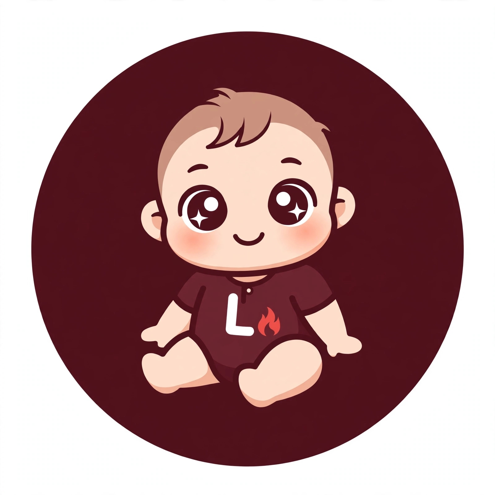

<p align="center">
  
</p>

<h1 align="center">Lume</h1>

<p align="center"><b>Bot conversacional que cresce com a ajuda dos humanos.</b></p>

<p align="center">
  <a href="https://github.com/adilson889/lume/stargazers"></a>
  <a href="LICENSE"></a>
  <a href="https://github.com/adilson889/lume/commits/main"></a>
  
  
  
</p>

<p align="center"><a href="README.md">Português</a> &nbsp;|&nbsp; <a href="README.en.md">English</a> &nbsp;|&nbsp; <a href="README.zh.md">中文</a></p>

---

## O que é o Lume?

O Lume é um **BOT conversacional**, desenvolvido integralmente com <a href="https://github.com/adilson889/botql">BotQL</a>, uma linguagem declarativa baseada em regras. Não é um modelo de linguagem treinado nem pretende ser apresentado como uma IA autónoma. É um bot que combina regras de conversa, ficheiros de conhecimento, conteúdos ensinados pelos utilizadores e pesquisa na web para interpretar mensagens e decidir como agir.

Mas a proposta do Lume vai além de responder a perguntas: **ele também pode pedir ajuda aos humanos**.

Quando não encontra uma resposta adequada, o Lume pode reconhecer essa limitação e abrir espaço para que alguém o ensine. O conhecimento recebido pode ser avaliado, corrigido e aprovado antes de passar a fazer parte da sua base de conhecimento. Assim, os humanos não são apenas pessoas que fazem perguntas: também participam no crescimento do bot.

> O Lume nasce sem saber tudo. Os humanos ajudam-no a crescer.

## Como funciona

Cada mensagem passa primeiro pelas regras de conversa (ajuda, saudações, despedidas, agradecimentos e estado). As restantes seguem uma cadeia de consulta:

1. **Conhecimento aprendido** (`aprendido.txt`): consulta conteúdos que o Lume já aprendeu com as pessoas e que estão disponíveis para utilização.
2. **Sondagem**: quando existem várias respostas possíveis, o Lume pode apresentá-las para o utilizador escolher.
3. **Pedido de ajuda ou resposta de reserva**: quando não encontra informação suficiente, pode solicitar ajuda ou apresentar uma resposta de reserva.

A sondagem apresenta as opções numeradas e termina assim que o utilizador escolhe uma.

> Desligado por agora: a base de programação (`conhecimento_programacao.txt`) e a pesquisa na Wikipédia. O ficheiro continua no repositório e pode ser ligado de novo acrescentando-o a `arquivos.json` e às linhas `THINK`/`ASK`/`SEARCH` de `main.sql`.

## Identificação da intenção

O chat utiliza <a href="https://github.com/axa-group/nlp.js">NLP.js</a>, incluído num único ficheiro (`LUME/vendor/nlp.min.js`, 127 KB), para classificar as mensagens. Entre as categorias estão conversa informal e mensagens fora do domínio.

O classificador é treinado quando a página abre, utilizando os exemplos de `LUME/bot/intencoes.txt`.

Para ensinar uma intenção, acrescenta linhas no formato `intencao | frase de exemplo` ao ficheiro `intencoes.txt`.

## Ensinar e corrigir o Lume

Os utilizadores podem avaliar as respostas com votos positivos ou negativos. Quando uma resposta recebe uma avaliação negativa, podem ensinar uma resposta alternativa através de um editor com formatação, pré-visualização e validação.

Os conteúdos ensinados ou recolhidos podem passar por revisão no painel de gestão, onde podem ser aprovados ou removidos. **O conteúdo só deve ser tratado como conhecimento disponível depois de passar pelo processo de validação definido pelo sistema.**

Este mecanismo representa aprendizagem por recolha, validação e persistência de conhecimento. Não significa que o bot altere autonomamente os seus próprios parâmetros ou se treine como um modelo de linguagem.

## Estrutura do repositório

```text
index.html                      chat (página estática, sem compilação)
LUME/
  bot/                          main.sql e os ficheiros de texto utilizados
    arquivos.json               lista dos ficheiros carregados pelo chat
    conhecimento_programacao.txt  (desligado por agora)
    intencoes.txt
    aprendido.txt
  vendor/nlp.min.js             NLP.js num único ficheiro
  assets/logo.png
  tests/casos_programacao.txt   casos de teste (pergunta | resposta esperada)
  editor/editor.html            mini editor/navegador das apps HTML (interface)
  editor/lume-editor.js         ponte do editor no chat (cartões de ficheiro)
  TEMPLATES.md                  como criar templates (páginas HTML/JS e XLang)
  COMPONENTES.md                gerador de código HTML + CSS (componentes.txt e cores.txt)
  CODIGO_TYPESCRIPT.md          gerador de código TypeScript por regras (codigo.js + vendor/xlang-codigo.js; ligado ao chat desde 0.5.48)
  CHANGELOG.txt
  VERSION
```

## Executar localmente

O Lume é uma página estática que carrega o motor do BotQL pela rede. É necessário servi-la por HTTP; abrir o ficheiro diretamente não funciona devido aos pedidos `fetch`.

```bash
git clone https://github.com/adilson889/lume.git
cd lume
python3 -m http.server 8000
# abrir http://localhost:8000
```

## Acrescentar conhecimento

Cada tema da base é um bloco separado por uma linha em branco, no formato `Tema (sinónimos): texto da resposta`.

Ao criar um ficheiro novo, adiciona-o a `LUME/bot/arquivos.json`, porque o chat só carrega os ficheiros indicados nessa lista. Os nomes dos ficheiros utilizados pelo BotQL devem ser simples: letras, números e sublinhado, sem pastas.

## Versões

As alterações de cada versão estão em <a href="LUME/CHANGELOG.txt">LUME/CHANGELOG.txt</a>, e a versão atual em <a href="LUME/VERSION">LUME/VERSION</a>.

## Licença

Distribuído sob a licença Apache 2.0. Consulta <a href="LICENSE">LICENSE</a>. O NLP.js, incluído em `LUME/vendor`, é distribuído sob a licença MIT.
