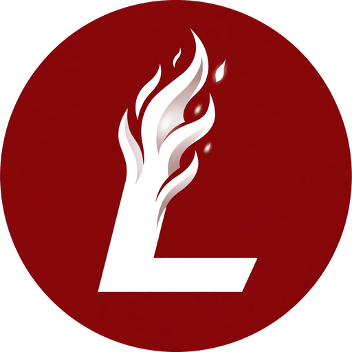

<p align="center">
  
</p>

<h1 align="center">Lume</h1>

<p align="center"><b>用 BotQL 编写的对话助手，以编程作为测试领域。</b></p>

<p align="center">
  <a href="https://github.com/adilson889/lume/stargazers"></a>
  <a href="LICENSE"></a>
  <a href="https://github.com/adilson889/lume/commits/main"></a>
  
  
  
</p>

<p align="center"><a href="README.md">Português</a> &nbsp;|&nbsp; <a href="README.en.md">English</a> &nbsp;|&nbsp; <a href="README.zh.md">中文</a></p>

---

## 简介

<p align="justify">
Lume 是完全用 <a href="https://github.com/adilson889/botql">BotQL</a> 构建的对话机器人。BotQL 是一种基于规则的声明式语言。Lume 不是训练出来的语言模型，而是把规则、手写知识库、从用户那里学到的内容以及网络搜索结合起来，并判断每条消息的意图，再决定如何处理。
</p>

<p align="justify">
测试领域是编程：变量、函数、循环、类、API、Git、SQL、HTML、CSS 等入门主题。目标是打造一个稳固、可扩展的基础，扩展时只需增加文本文件，而不必重写逻辑。
</p>

## 回答流程

<p align="justify">
每条消息先经过对话规则（帮助、问候、告别、感谢、状态）。剩下的消息进入一条链，上一步无法解决时才由下一步处理：
</p>

1. **手写知识库**（`conhecimento_programacao.txt`）：直接回答。
2. **已学习内容**（`aprendido.txt`）：Lume 已经学到的内容，直接回答；如有疑问，则弹出投票让用户选择。
3. **网络搜索**（维基百科）：仅当消息看起来像编程问题时才会运行，结果会保存到已学习文件中。
4. **知识库投票**：存在多个可能答案时使用。
5. **兜底回复**：以上都不适用时使用。

<p align="justify">
投票会为可能的答案编号，用户一旦选择，投票就会消失。
</p>

## 消息意图

<p align="justify">
聊天页面使用 <a href="https://github.com/axa-group/nlp.js">NLP.js</a>，它被打包成单个文件（<code>LUME/vendor/nlp.min.js</code>，127 KB），用来把每条消息分为：知识库中的某个主题、闲聊、与主题无关，或知识库尚未涵盖的编程问题。页面打开时它会用知识库主题和 <code>LUME/bot/intencoes.txt</code> 中的示例进行训练，耗时不到一秒。这样，像“梅西是谁？”这样的问题就不会跑到网上带回无关内容。
</p>

<p align="justify">
要教它新的意图，只需在 <code>intencoes.txt</code> 中添加格式为 <code>意图 | 示例句子</code> 的行。
</p>

## 向用户学习

<p align="justify">
每条回答都可以点赞或点踩。点踩后，用户可以在带有格式、预览和校验的编辑器中教它正确答案（校验内容包括长度、HTML 只能放在代码块中、链接只能指向维基百科和 Stack Overflow）。教给它或它学到的内容，都可以在管理面板中审核、批准或删除。
</p>

## 仓库结构

```text
index.html                  聊天页面（静态页面，无需构建）
LUME/
  bot/                      main.sql 及其使用的文本文件
    arquivos.json           聊天页面要加载的文件列表
    conhecimento_programacao.txt
    intencoes.txt
    aprendido.txt
  vendor/nlp.min.js         单文件版 NLP.js
  assets/logo.png
  tests/casos_programacao.txt   测试用例（问题 | 期望答案）
  CHANGELOG.txt, VERSION
```

## 本地运行

<p align="justify">
Lume 是一个静态页面，通过网络加载 BotQL 引擎。只需用 HTTP 服务器提供它即可（直接打开文件无效，因为需要 <code>fetch</code> 请求）：
</p>

```bash
git clone https://github.com/adilson889/lume.git
cd lume
python3 -m http.server 8000
# 打开 http://localhost:8000
```

## 添加知识

<p align="justify">
知识库中的每个主题是一个用空行分隔的块，格式为 <code>主题（同义词）：回答内容</code>。新建文件后，需要把它列入 <code>LUME/bot/arquivos.json</code>，因为聊天页面只会加载该列表中的文件。BotQL 的文件名必须简单：只能包含字母、数字和下划线，不能带文件夹。
</p>

## 版本

<p align="justify">
每个版本的变更见 <a href="LUME/CHANGELOG.txt">LUME/CHANGELOG.txt</a>，当前版本见 <a href="LUME/VERSION">LUME/VERSION</a>。
</p>

## 许可证

<p align="justify">
基于 Apache 2.0 许可证发布，详见 <a href="LICENSE">LICENSE</a>。<code>LUME/vendor</code> 中包含的 NLP.js 基于 MIT 许可证发布。
</p>
